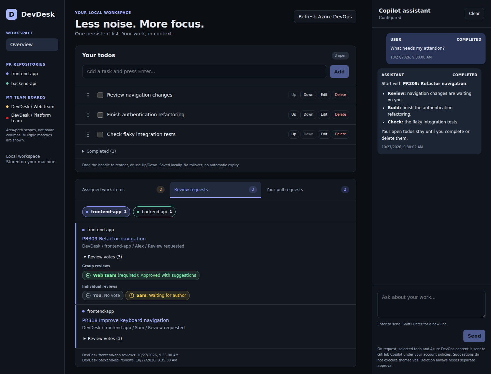
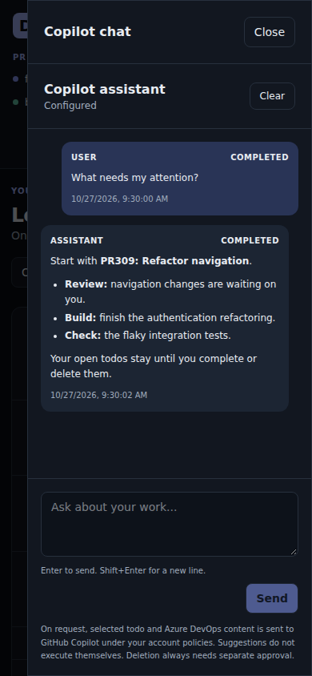

# DevDesk

A local developer dashboard for keeping your todos, Azure DevOps work, and
GitHub Copilot conversation in one place. Runs on your machine with Docker.



Screenshots show the application with synthetic data.

<details>
<summary>Mobile chat</summary>



</details>

## Features

- **Persistent todos:** reorder, complete, reopen, and link tasks to work items or
  pull requests. No daily resets or automatic expiry.
- **Azure DevOps overview:** assigned work items, review requests, and your pull
  requests, with team/repository filters, review votes, and background refresh.
- **Source settings:** choose readable team-area scopes and repositories across
  your organization's projects. The saved selection governs sync, current
  dashboard data, and new assistant retrievals.
- **Copilot assistant:** ask about your work or request todo changes. Replies
  support Markdown; deletion requires separate confirmation.

## Quick Start

Requires Docker Engine and Docker Compose on Linux or WSL2. No host Node.js,
external database, or MCP server is needed.

1. Clone and prepare a new checkout:

    ```sh
    git clone https://github.com/lukehartmann-vertigis/daily-digest.git
    cd daily-digest
    cp .env.example .env
    chmod 600 .env
    ```

    For an existing checkout, keep your current `.env`.

2. Set `AZURE_DEVOPS_PAT` and/or `COPILOT_GITHUB_TOKEN` in `.env` as described
   below. Either can stay blank; local todos work without integrations.

3. Start the app:

    ```sh
    docker compose up -d --build --wait
    ```

4. Open **http://localhost:3000**, then **Settings** to select **Work Item Sources**
   and **Repositories**. Save explicitly; both lists start empty, including after
   an upgrade. Either list may stay empty. Local todos work without any sources.

## Configuration

| Variable               | Purpose                                                                                                                                                                      |
| ---------------------- | ---------------------------------------------------------------------------------------------------------------------------------------------------------------------------- |
| `AZURE_DEVOPS_PAT`     | PAT with read-only **Code**, **Work Items**, **Graph**, and **Project and Team** permissions for your organization and selected scopes.                                      |
| `COPILOT_GITHUB_TOKEN` | Fine-grained personal GitHub PAT with the account permission **Copilot Requests**. Requires Copilot/model access and available usage. Classic `ghp_` PATs are not supported. |

Set `AZURE_DEVOPS_ORG` for your organization; the connection default is `vertigis`.
Sources are selected only in Settings, never imported from environment defaults.
`AZURE_DEVOPS_PROJECTS` and `AZURE_DEVOPS_REPOSITORY_IDS` are deprecated, ignored,
and reported in Settings. See [.env.example](.env.example). The default Copilot
model is `gpt-4.1`; Azure DevOps refreshes at startup and 180 seconds after each
cycle completes. Both are configurable; there is no silent model fallback.

DevDesk uses only the supplied tokens, not your VS Code or GitHub CLI login.
Organization policies and permissions still apply. Missing Graph access degrades
review requests without disabling todos or other synchronized datasets. See the
[Copilot SDK authentication contract](https://github.com/github/copilot-sdk/blob/main/docs/auth/authenticate.md)
for other supported explicit user tokens.

After changing `.env`, recreate the container:

```sh
docker compose up -d --force-recreate --wait
```

## Usage

- **Settings:** search the project-grouped Work Item Sources and Repositories
  lists, select checkboxes, and Save. Cancel restores the saved selection.
  Work Item Sources include all readable teams, not just your memberships, and
  show **your assigned items in selected team areas**, not an exact Kanban board.
  Projects only group choices; there is no separate project picker. Selection is
  stored in SQLite per organization and applies immediately without restart.
  Unavailable saved sources remain visible and removable. A conflict requires
  reloading the saved selection before retrying.
- **Todos:** enter a title, then edit, complete/reopen, or delete with confirmation.
  Drag a grip to reorder, or use Up/Down. Keyboard sorting: Space to pick up/drop,
  arrows to move, Escape to cancel. Completed tasks stay in a collapsed section.
  Edit a todo to attach a work-item or PR link.
- **Azure DevOps:** switch between the three tabs; use the chips to select a team
  or repository. Each tab retains its selection until reload. Tab counts include
  the full cached dataset; chip counts are per scope. Expand review votes for
  group and individual decisions. Stale or unavailable data is marked.
- **Assistant:** ask in English or German, for example, "Which PRs need review?"
  or "Create a todo to check the integration tests." Enter sends; Shift+Enter
  adds a newline. Todo changes can execute when requested; suggestions alone do
  not. AI deletion needs a separate approval, valid for five minutes.
- **Chat history:** messages persist across restarts. Clear removes the local
  conversation and app-owned SDK session, not todos. On narrow screens, use
  **Open chat** to access the drawer.

## Data, Privacy & Limitations

- Todos, cached Azure DevOps data, and chat state are stored in the local
  `devdesk-data` Docker volume, together with source settings. Host permissions protect access; data is not
  encrypted by the app. **Do not use `docker compose down -v` unless you intend
  to delete that data.**
- Requested todo and Azure DevOps context is sent to GitHub Copilot under your
  account policies. Clearing local chat does not erase provider-side retention
  or backups.
- Azure DevOps access is read-only. The assistant has scoped application tools,
  not general shell, filesystem, browsing, or MCP access.
- Deselecting sources hides their current cache data and blocks new detail and
  reference reads. It does not delete todos, historical links, conversation
  history, or already supplied provider context.
- Keep tokens in `.env`, never in source code or chat. Do not share resolved
  Compose configuration; it can contain credentials.
- This is a **single-user, local-only app without a login**. Keep the loopback
  binding, run one replica, and do not expose it publicly.

## Operations

```sh
docker compose logs --tail=100 app    # Inspect logs
docker compose stop                 # Stop without deleting data
docker compose up -d --wait          # Start again
```

To update, back up first, update the checkout, then run
`docker compose up -d --build --wait`. After configuration changes, use
`--force-recreate` instead of a restart.

For health checks, troubleshooting, backup, restore, and rollback, see the
[operations guide](docs/operations.md).

## Development & Documentation

Built with Next.js, React, TypeScript, SQLite/Drizzle, and the GitHub Copilot SDK.
For local development, use Node.js 24 LTS:

```sh
npm ci --ignore-scripts
npm run dev
```

Quality checks:

```sh
npm run typecheck
npm run lint
npm test
npm run format:check
npm run build
```

Default tests are offline. `npm run test:e2e` uses Playwright 1.64.1 and mutates
records: point `DEVDESK_TEST_URL` at an **isolated running instance**, never your
normal workspace. It defaults to `http://127.0.0.1:3000`.

- [Architecture](docs/architecture.md): modules, persistence, and integration boundaries.
- [Requirements](docs/requirements/REQUIREMENTS.md): todo, Azure DevOps, assistant, and UX contracts.
- [Settings requirements](docs/requirements/settings.md): persisted Azure DevOps source
  selection and [ADR-0015](docs/adr/0015-persisted-azure-devops-settings.md).
- [Code style](docs/code-style.md): conventions and contribution checks.
- [Verification](docs/verification/application.md): completed checks and remaining live-account limits.
- [Design preview](clickdummy.html): standalone interactive demo, not the running app.
